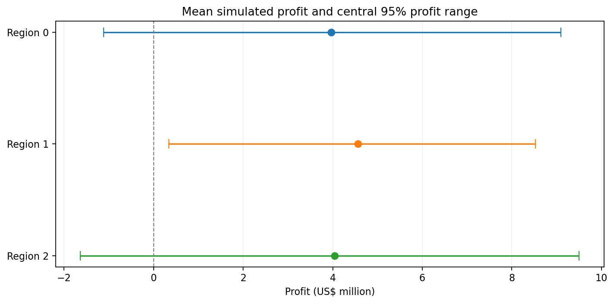
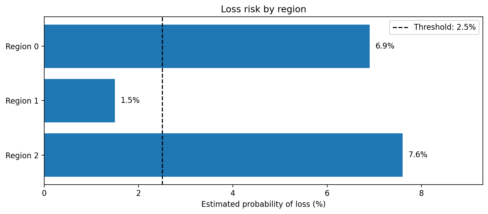

[English](README.md) | [Português (Brasil)](README.pt-BR.md)

# OilyGiant — Oil Well Selection and Investment Risk Analysis

**TripleTen Data Science Bootcamp | Sprint 10 Project**

## Project Overview

This project evaluates how machine learning can support investment decisions in oil exploration. The fictional company **OilyGiant** must choose one of three regions in which to develop 200 new oil wells.

The objective is to **select the region with the highest estimated mean profit while keeping the probability of financial loss below 2.5%**. The decision is evaluated under a stipulated exploration scenario: 500 candidate locations are assessed, and the 200 with the highest predicted reserves are selected for development.

A separate linear regression model is trained for each region to estimate oil reserves from three geological features. The models' predictions determine which wells are selected; the recorded reserve volumes in held-out data are used to calculate the resulting profits. Bootstrap resampling is then used to examine how the strategy performs across different candidate samples.

## Results

**Region 1 is the recommended investment under the evaluated model-driven selection strategy.** It achieved the highest mean simulated profit (**US$4.56 million**) and was the only region to meet the **2.5% maximum loss-risk criterion**, with an estimated loss probability of **1.5%**.

### Model Performance

| Region | Mean predicted reserves (thousand barrels) | Validation RMSE (thousand barrels) |
|---|---:|---:|
| Region 0 | 92.59 | 37.58 |
| **Region 1** | **68.73** | **0.89** |
| Region 2 | 94.97 | 40.03 |

Each model uses a 75/25 train-validation split. RMSE measures predictive error on the held-out validation data; it does not by itself determine investment profitability.

### Profit and Risk Comparison

| Region | Mean simulated profit (US$M) | Central 95% of simulated profits (US$M) | Estimated loss probability | Meets risk limit? |
|---|---:|---:|---:|---|
| Region 0 | 3.96 | −1.11 to 9.10 | 6.9% | No |
| **Region 1** | **4.56** | **0.34 to 8.52** | **1.5%** | **Yes** |
| Region 2 | 4.04 | −1.63 to 9.50 | 7.6% | No |

*Results are based on 1,000 bootstrap iterations per region. The central 95% range describes the distribution of simulated profits; it is not a 95% confidence interval for mean profit.*

### Profit and Risk Visualizations





### Key Findings

A preliminary analysis selected the 200 highest-ranked wells from approximately **25,000 validation candidates per region**. In that specific selection, **Region 0 generated the highest calculated profit (US$33.21 million)**.

However, this preliminary exercise differs from OilyGiant's stipulated scenario, in which the model must select 200 wells from **only 500 candidates**. Under repeated bootstrap samples of that smaller candidate pool, Region 0 had a higher estimated probability of loss (6.9%) than Region 1 (1.5%) and a lower mean simulated profit.

The recommendation is therefore **not that Region 1 necessarily contains the most oil or the most profitable individual wells**. Rather, among the three regions, its trained model produced the most favorable estimated financial results for the specified selection strategy and risk constraint.

## Project Objectives

- Explore and assess the quality of the three regional datasets.
- Train separate linear regression models to predict reserves at candidate well locations.
- Evaluate prediction accuracy using root mean squared error (RMSE).
- Select wells using predicted reserves and calculate profit using recorded reserve volumes.
- Estimate mean profit, the distribution of outcomes, and loss probability through bootstrap resampling.
- Recommend an investment region under the company's financial constraints.

## Data

The project uses three **synthetic datasets**, each containing **100,000 observations**, provided for the TripleTen OilyGiant case study.

| Dataset | Description |
|---|---|
| `geo_data_0.csv` | Candidate oil-well locations in Region 0. |
| `geo_data_1.csv` | Candidate oil-well locations in Region 1. |
| `geo_data_2.csv` | Candidate oil-well locations in Region 2. |

Each dataset includes `id` (location identifier), `f0`, `f1`, and `f2` (geological features with unspecified physical meanings), and `product` (oil reserves in **thousands of barrels**).

The analysis identifies a small number of repeated identifiers but no missing values or fully duplicated rows. Identifiers are excluded from the predictive features, and row indices are used to align predictions with observed values.

## Modeling and Financial Evaluation

**Modeling.** A separate scikit-learn `LinearRegression` model is trained for each region using a 75/25 train-validation split. A `Pipeline` applies `StandardScaler` using the training set only, avoiding validation-data leakage. The model uses `f0`, `f1`, and `f2` to predict `product`.

**Financial assumptions.** OilyGiant allocates **US$100 million** to developing 200 wells. Revenue is estimated at **US$4.50 per barrel**, equivalent to US$4,500 per unit of `product`. The resulting break-even production volume is approximately **111.11 thousand barrels per developed well**, on average.

**Selection and resampling.** For each region, the bootstrap procedure draws 500 validation observations **with replacement**, ranks them by their model-predicted reserves, selects the top 200, and calculates profit from their recorded reserves. This is repeated **1,000 times** per region. The share of simulations with negative profit estimates the loss probability under this procedure.

The final decision selects the highest-mean-profit region among those with an estimated loss probability **strictly below 2.5%**.

## Repository Structure

```text
TT-Sprint10-Project/
├── README.md
├── .gitignore
├── project_description.md
├── pyproject.toml
├── assets/
│   └── figures/
│       ├── profit_intervals.png
│       ├── loss_risk.png
│       ├── lucro_intervalos.png
│       └── risco_prejuizo.png
├── datasets/
│   ├── geo_data_0.csv
│   ├── geo_data_1.csv
│   └── geo_data_2.csv
└── notebooks/
    ├── sprint10_project.en-US.ipynb
    └── sprint10_project.pt-BR.ipynb
```

The current notebook is written in Brazilian Portuguese. English-language notebook and figure versions, along with `README.pt-BR.md`, are planned but are not yet included in the repository.

## Running the Notebook

The analysis is available in [`notebooks/sprint10_project.en-US.ipynb`](notebooks/sprint10_project.en-US.ipynb).

A Python environment with **pandas, NumPy, scikit-learn, Matplotlib, and IPython**, plus a Jupyter-compatible interface, is required. The repository also includes a `environment.yml` file for project configuration.

1. Clone or download the repository and install the required Python packages in your preferred environment.
2. Open the notebook in VS Code, JupyterLab, or another Jupyter-compatible application.
3. Ensure its working directory is `notebooks/`, so `../datasets/` and `../assets/figures/` resolve correctly.
4. Run the cells in order to reproduce the analysis and regenerate the figures.

## Project Scope and Limitations

The datasets are synthetic, and the financial scenario uses fixed revenue and investment assumptions rather than well-specific drilling costs or changing oil prices.

Bootstrap sampling approximates future candidate sets using the empirical distribution of the held-out observations. Because resampling uses replacement, an observation can appear more than once in a simulated selection; the procedure is not a literal drilling plan for 200 distinct physical locations.

The estimated loss probabilities are conditional on the datasets, fitted models, financial assumptions, and resampling procedure. They are **not verified real-world investment risks**. Real deployment would require new data, operational and geological validation, and more detailed financial modeling.

## Author

Developed by **Daniel Endless** as a Sprint 10 project in the TripleTen Data Science Bootcamp.

[GitHub Profile](https://github.com/danendless)
