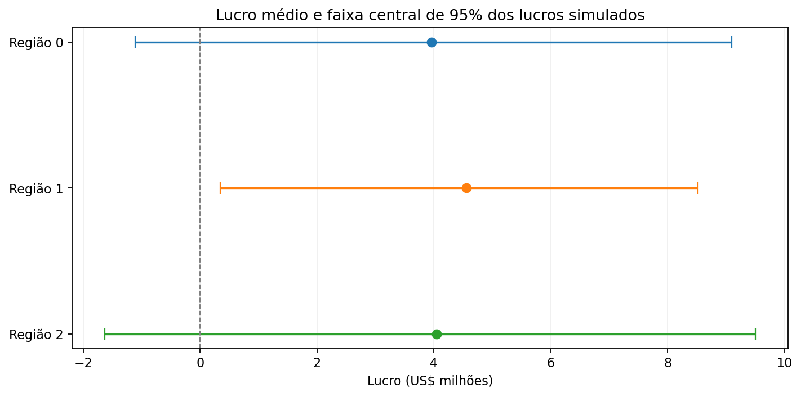
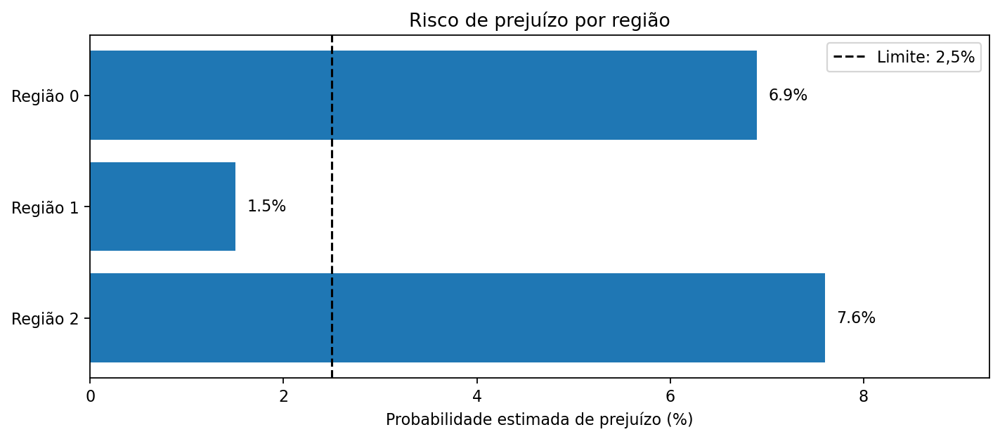

[English](README.md) | **Português (Brasil)**

# OilyGiant — Seleção de Poços de Petróleo e Análise de Risco de Investimento

**TripleTen Data Science Bootcamp | Projeto do Sprint 10**

## Visão Geral do Projeto

Este projeto avalia como o aprendizado de máquina pode apoiar decisões de investimento na exploração de petróleo. A empresa fictícia **OilyGiant** precisa escolher uma entre três regiões para o desenvolvimento de 200 novos poços de petróleo.

O objetivo é **identificar a região com o maior lucro médio estimado, mantendo a probabilidade de prejuízo abaixo de 2,5%**. A decisão é avaliada segundo uma premissa operacional: são analisadas 500 localizações candidatas, das quais as 200 com maiores reservas previstas são selecionadas para desenvolvimento.

Um modelo de regressão linear é treinado para cada região, utilizando três características geológicas para estimar o volume de reservas. As previsões determinam quais poços são selecionados, enquanto os volumes de reservas registrados no conjunto de validação são utilizados para calcular os lucros. A técnica de *bootstrapping* permite examinar o desempenho dessa estratégia em diferentes amostras de candidatos.

## Resultados

**A Região 1 é a recomendada para investimento sob a estratégia de seleção baseada nos modelos avaliados.** Ela apresentou o maior lucro médio simulado (**US$ 4,56 milhões**) e foi a única a atender ao **limite de risco de prejuízo de 2,5%**, com probabilidade estimada de **1,5%**.

### Desempenho dos Modelos

| Região | Reservas médias previstas (mil barris) | REQM na validação (mil barris) |
|---|---:|---:|
| Região 0 | 92,59 | 37,58 |
| **Região 1** | **68,73** | **0,89** |
| Região 2 | 94,97 | 40,03 |

Cada modelo utiliza uma divisão de 75% dos dados para treinamento e 25% para validação. A raiz do erro quadrático médio (REQM, ou RMSE) mede o erro preditivo nos dados de validação, mas não determina, isoladamente, a rentabilidade do investimento.

### Comparação de Lucros e Riscos

| Região | Lucro médio simulado (US$ milhões) | Faixa central de 95% dos lucros simulados (US$ milhões) | Probabilidade estimada de prejuízo | Atende ao limite de risco? |
|---|---:|---:|---:|---|
| Região 0 | 3,96 | −1,11 a 9,10 | 6,9% | Não |
| **Região 1** | **4,56** | **0,34 a 8,52** | **1,5%** | **Sim** |
| Região 2 | 4,04 | −1,63 a 9,50 | 7,6% | Não |

*Resultados obtidos com 1.000 iterações de bootstrap por região. A faixa central de 95% descreve a distribuição dos lucros simulados; não representa um intervalo de confiança de 95% para o lucro médio.*

### Visualizações de Lucros e Riscos





### Principais Resultados

Uma análise preliminar selecionou os 200 poços com maiores reservas previstas entre aproximadamente **25.000 candidatos de validação por região**. Nessa seleção específica, **a Região 0 apresentou o maior lucro calculado (US$ 33,21 milhões)**.

Entretanto, esse exercício preliminar difere do cenário estabelecido para a OilyGiant, no qual os modelos precisam selecionar 200 poços entre **apenas 500 candidatos**. Nas repetidas amostras de bootstrap desse conjunto menor, a Região 0 apresentou maior probabilidade estimada de prejuízo (6,9%) do que a Região 1 (1,5%), além de um lucro médio simulado inferior.

Portanto, a recomendação **não significa que a Região 1 necessariamente possua as maiores reservas ou os poços individualmente mais rentáveis**. Entre as três regiões, foi a estratégia de seleção baseada em seu modelo que apresentou os resultados financeiros estimados mais favoráveis, considerando o limite de risco estabelecido.

## Objetivos do Projeto

- Explorar os três conjuntos de dados regionais e avaliar sua qualidade.
- Treinar modelos de regressão linear separados para prever reservas de petróleo em possíveis localizações de poços.
- Avaliar a precisão das previsões por meio da raiz do erro quadrático médio (REQM).
- Selecionar poços com base nas reservas previstas e calcular o lucro utilizando os volumes registrados nos dados.
- Estimar o lucro médio, a distribuição dos resultados e a probabilidade de prejuízo com a técnica de *bootstrapping*.
- Recomendar uma região para investimento de acordo com as restrições financeiras da empresa.

## Dados

O projeto utiliza três **conjuntos de dados sintéticos**, cada um com **100.000 observações**, fornecidos no estudo de caso OilyGiant da TripleTen.

| Conjunto de dados | Descrição |
|---|---|
| `geo_data_0.csv` | Localizações candidatas para poços de petróleo na Região 0. |
| `geo_data_1.csv` | Localizações candidatas para poços de petróleo na Região 1. |
| `geo_data_2.csv` | Localizações candidatas para poços de petróleo na Região 2. |

Cada conjunto contém `id` (identificador da localização), `f0`, `f1` e `f2` (características geológicas sem significado físico especificado) e `product` (volume de reservas em **milhares de barris**).

A análise identificou um pequeno número de identificadores repetidos, mas nenhum valor ausente ou linha inteiramente duplicada. Os identificadores não são utilizados como variáveis preditoras, e os índices das linhas preservam a correspondência entre previsões e valores observados.

## Modelagem e Avaliação Financeira

**Modelagem.** Um modelo `LinearRegression`, do scikit-learn, é treinado para cada região, utilizando uma divisão de 75% para treinamento e 25% para validação. Uma `Pipeline` aplica `StandardScaler` com ajuste apenas nos dados de treinamento, evitando vazamento de dados da validação. O modelo utiliza `f0`, `f1` e `f2` para prever `product`.

**Premissas financeiras.** A OilyGiant dispõe de **US$ 100 milhões** para desenvolver 200 poços. A receita estimada é de **US$ 4,50 por barril**, equivalente a US$ 4.500 por unidade de `product`. O volume médio necessário para atingir o ponto de equilíbrio é, portanto, de aproximadamente **111,11 mil barris por poço desenvolvido**.

**Seleção e reamostragem.** Para cada região, o procedimento de bootstrap sorteia 500 observações do conjunto de validação **com reposição**, classifica-as pelas reservas previstas pelo modelo, seleciona as 200 primeiras e calcula o lucro usando os volumes de reservas registrados. O processo é repetido **1.000 vezes** por região. A proporção de simulações com lucro negativo estima a probabilidade de prejuízo sob esse procedimento.

A decisão final seleciona a região com o maior lucro médio simulado entre aquelas cuja probabilidade estimada de prejuízo é **estritamente inferior a 2,5%**.

## Estrutura do Repositório

```text
TT-Sprint10-Project/
├── README.md
├── README.pt-BR.md
├── .gitignore
├── project_description.md
├── pyproject.toml
├── assets/
│   └── figures/
│       ├── profit_intervals.png
│       ├── loss_risk.png
│       ├── lucro_intervalos.png
│       └── risco_prejuizo.png
├── datasets/
│   ├── geo_data_0.csv
│   ├── geo_data_1.csv
│   └── geo_data_2.csv
└── notebooks/
    ├── sprint10_project.en-US.ipynb
    └── sprint10_project.pt-BR.ipynb
```

O notebook atual está escrito em português brasileiro. Estão previstas versões em inglês do notebook e das figuras, que ainda não fazem parte do repositório.

## Como Executar o Notebook

A análise está disponível em [`notebooks/sprint10_project.pt-BR.ipynb`](notebooks/sprint10_project.pt-BR.ipynb).

É necessário um ambiente Python com **pandas, NumPy, scikit-learn, Matplotlib e IPython**, além de uma interface compatível com Jupyter. O repositório também contém um arquivo `environment.yml` para configuração do projeto.

1. Clone ou baixe o repositório e instale as bibliotecas Python necessárias no ambiente de sua preferência.
2. Abra o notebook no VS Code, JupyterLab ou em outra interface compatível com Jupyter.
3. Verifique se o diretório de trabalho é `notebooks/`, para que os caminhos `../datasets/` e `../assets/figures/` sejam resolvidos corretamente.
4. Execute as células em ordem para reproduzir a análise e gerar novamente as figuras.

## Escopo e Limitações

Os dados são sintéticos e o cenário financeiro utiliza premissas fixas de receita e investimento, sem incorporar custos específicos de perfuração por poço ou variações no preço do petróleo.

A reamostragem por bootstrap aproxima futuros conjuntos de candidatos por meio da distribuição empírica das observações de validação. Como a amostragem ocorre com reposição, uma observação pode aparecer mais de uma vez na mesma seleção simulada; o procedimento não representa um plano literal de perfuração de 200 localizações físicas distintas.

As probabilidades estimadas de prejuízo são condicionadas aos dados, aos modelos ajustados, às premissas financeiras e ao procedimento de reamostragem. **Não representam riscos de investimento verificados em condições reais.** Uma aplicação operacional exigiria novos dados, validação geológica e operacional e uma modelagem financeira mais detalhada.

## Autor

Desenvolvido por **Daniel Endless** como projeto do Sprint 10 do TripleTen Data Science Bootcamp.

[Perfil no GitHub](https://github.com/danendless)
